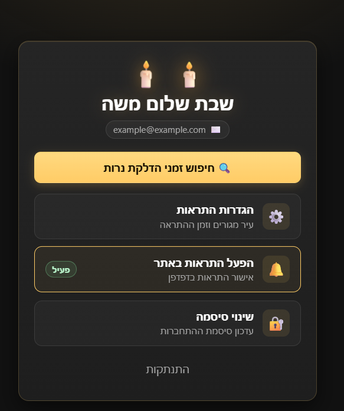
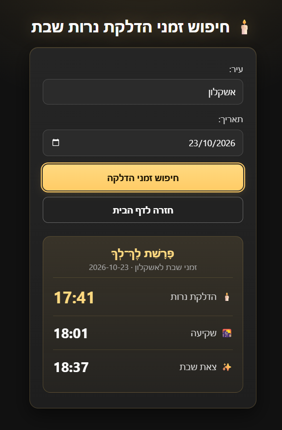
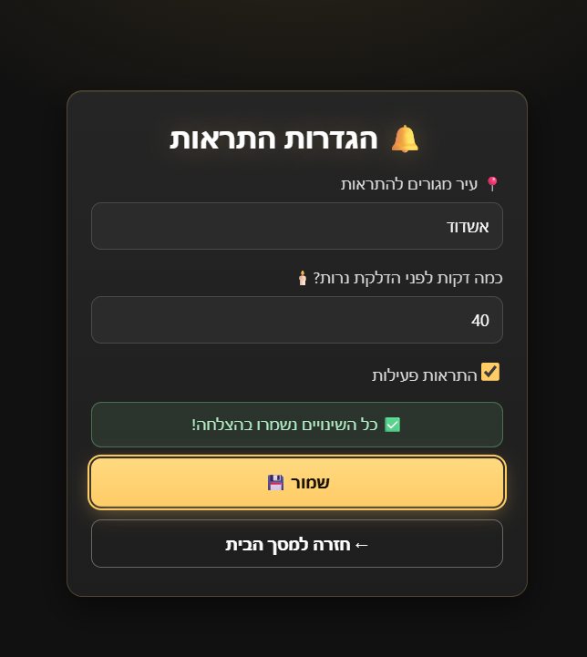
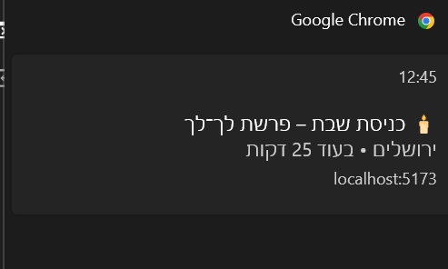

# Shabbat Candles 🕯️

Candle-lighting times and a gentle reminder before Shabbat begins.

## Overview

Shabbat Candles is a Hebrew (RTL) web app. Search the candle-lighting, sunset and havdalah times, plus the weekly parasha, for any city in Israel. Save your city and a reminder time, and the app sends a personal notification shortly before Shabbat enters, for example **"🕯️ כניסת שבת – פרשת נח"** with **"ירושלים • בעוד 25 דקות"**.

## Features

- **Accounts:** register with a display name, email and password, then log in with email and password.
- **Sessions:** the login lasts one hour. When it expires, the app returns to the login screen with a clear message.
- **Change password** from inside the app.
- **Shabbat times:** candle lighting, sunset, havdalah and the parasha for any Israeli city and date.
- **Alert settings:** your city, how many minutes before candle lighting to be reminded, and an on/off switch.
- **Personal alerts:** a server-side scheduler creates the reminder, including the parasha and your city.
- **Browser notifications** with a soft two-note sound.
- **Dark theme** with a candle and gold palette, responsive on phones and desktop.

## Screenshots

<p align="center">
  <br>
  <em>Home dashboard</em>
</p>

<table>
  <tr>
    <td align="center" valign="top">
      <br>
      <em>Shabbat times search</em>
    </td>
    <td align="center" valign="top">
      <br>
      <em>Alert settings</em>
    </td>
  </tr>
</table>

<p align="center">
  <br>
  <em>Browser notification</em>
</p>

## Tech Stack

| Area | Technology |
|---|---|
| Frontend | React 19, Vite 7 |
| Backend | Node.js (≥ 20.19), Express 4 |
| Database | PostgreSQL (`pg`) |
| Auth | JSON Web Tokens (`jsonwebtoken`), password hashing with `bcrypt` |
| Scheduling | `node-cron` |

**External services**

- [Hebcal](https://www.hebcal.com/) for candle-lighting, havdalah and parasha data.
- [Nominatim / OpenStreetMap](https://nominatim.openstreetmap.org/) for city geocoding. Map data © OpenStreetMap contributors.

Both are public APIs, called from the server with an identifying `User-Agent`.

## Architecture / Project Structure

```
.
├── client/                  React + Vite frontend
│   └── src/
│       ├── App.jsx          Screen routing, session state, registration
│       ├── Login.jsx, Home.jsx, NewCandle.jsx (Shabbat times search),
│       │   ChangePassword.jsx, AlertSettings.jsx
│       ├── authFetch.js     Authenticated fetch + session-expiry handling
│       ├── notifications.js Browser notification permission and sound
│       ├── api.js           API base URL
│       └── index.css        Theme and shared styles
├── server/                  Express API
│   ├── server.js            Auth, alert settings, alerts, location endpoints
│   ├── shabbatRoutes.js     GET /api/shabbat-times
│   ├── shabbatService.js    Hebcal lookup (candle time + parasha)
│   ├── alertScheduler.js    Cron job that creates alerts
│   ├── alertMessage.js      Alert title/body text
│   ├── dateUtils.js, db.js
│   ├── database/            schema.sql, migrations, verify.sql
│   └── tests/               Unit tests
└── docs/screenshots/        README images
```

**How the pieces fit together**

```
Browser (React) ──► Express API ──► PostgreSQL
                         ▲
alertScheduler (cron, every minute) ──► Hebcal ──► user_alerts
Home screen polls GET /api/alerts every 20 s ──► Browser notification ──► PATCH /read
```

1. Every minute the scheduler checks users who enabled alerts and have a saved location.
2. When the current time falls between *candle lighting minus your reminder time* and candle lighting, it creates one alert for that Friday. A `last_sent_at` check, together with a row lock, prevents duplicates.
3. While the Home screen is open with notification permission granted, the app fetches unread alerts, shows each as a browser notification and marks it as read.

**API endpoints**

| Method | Path | Auth | Purpose |
|---|---|---|---|
| POST | `/api/register` | – | Create an account (`fullName`, `email`, `password`) |
| POST | `/api/login` | – | Log in, returns a JWT and the display name |
| GET | `/api/shabbat-times?city=…&date=YYYY-MM-DD` | – | Candle lighting, sunset, havdalah, parasha |
| POST | `/api/change-password` | JWT | Change the password |
| GET / PUT | `/api/alerts/settings` | JWT | Read or update `minutes_before` and `enabled` |
| GET / PUT | `/api/user/location` | JWT | Read or save the user's city and coordinates |
| GET | `/api/alerts` | JWT | Unread alerts |
| PATCH | `/api/alerts/:id/read` | JWT | Mark an alert as read |

Protected endpoints expect `Authorization: Bearer <token>`. An expired token returns `401` with `code: "TOKEN_EXPIRED"`.

## Getting Started

**Prerequisites:** Node.js 20.19 or newer, npm, and PostgreSQL.

```bash
git clone <repository-url>
cd <repository-folder>
```

## Environment Variables

Copy the example files and fill in your own values. Never commit a real `.env`.

**`server/.env`** (from `server/.env.example`)

| Variable | Required | Description |
|---|---|---|
| `DB_HOST`, `DB_PORT` | yes | PostgreSQL host and port (for example `localhost` and `5432`) |
| `DB_NAME`, `DB_USER`, `DB_PASSWORD` | yes | Database name and credentials |
| `JWT_SECRET` | yes | Secret used to sign tokens. **At least 32 characters**; the server refuses to start without it |
| `PORT` | no | API port, defaults to `3000` |
| `CORS_ORIGIN` | no | Allowed browser origin, for example `http://localhost:5173`. When unset, any origin is allowed |
| `TZ` | no | Server timezone, defaults to `Asia/Jerusalem` |

Generate a secret without sharing it:

```bash
node -e "console.log(require('crypto').randomBytes(32).toString('hex'))"
```

Changing `JWT_SECRET` signs everyone out, because existing tokens stop being valid.

**`client/.env`** (optional, from `client/.env.example`)

| Variable | Description |
|---|---|
| `VITE_API_BASE_URL` | API address, defaults to `http://localhost:3000` |

## PostgreSQL Setup / Migrations

**New database**

1. Create an empty database, for example `shabbat_candles_portfolio`, and put its name in `server/.env`.
2. Run `server/database/schema.sql` on it once (pgAdmin Query Tool or `psql -d <db> -f server/database/schema.sql`).
3. Optionally run `server/database/verify.sql` to inspect the tables and constraints.

**Existing database from an earlier version**

Do not run `schema.sql` again. Run the migrations instead, in this order. Both are safe to repeat:

```sql
-- server/database/migration_add_city.sql
ALTER TABLE users ADD COLUMN IF NOT EXISTS city VARCHAR(100);

-- server/database/migration_add_full_name.sql
ALTER TABLE users ADD COLUMN IF NOT EXISTS full_name VARCHAR(100);
```

Users who registered before `full_name` existed keep working; their display name is simply empty.

Timestamps use `timestamp without time zone` and are stored as Israel local time.

## Run Server + Client

**Server** (terminal 1)

```bash
cd server
cp .env.example .env     # on Windows PowerShell: Copy-Item .env.example .env
# edit .env with your database settings and a JWT_SECRET
npm ci
npm run dev              # or: npm start
```

The API listens on `http://localhost:3000`, and the alert scheduler starts with it.

**Client** (terminal 2)

```bash
cd client
npm ci
npm run dev
```

Open the address Vite prints, usually `http://localhost:5173`.

**Quick smoke test:** register → log in → search a city and a date → save your city and reminder time in Alert Settings → enable browser notifications → change your password → log out and back in.

## Tests / Build

```bash
cd server && npm test        # unit tests: dates, Hebcal parsing, alert text
cd client && npm run lint    # ESLint
cd client && npm run build   # production build
```

## Security / Current Limitations

- **Authentication:** the JWT is stored in `localStorage` and there are no refresh tokens yet. Sessions last one hour.
- **Notifications:** browser notifications are not true push notifications. The web app (the Home screen) must be open, with notification permission granted.
- **Region:** the app is designed for Israel and the `Asia/Jerusalem` timezone.
- **Rate limiting:** not implemented yet on the authentication routes.
